# 📸 Nexora Live Production: Aligned Before & After Visual Progression

<strong>Live Frontend Target:</strong> [https://nexora-frontend-hazel.vercel.app](https://nexora-frontend-hazel.vercel.app)  
<strong>Live Backend Target:</strong> [https://nexora-backend-5ie2.onrender.com](https://nexora-backend-5ie2.onrender.com)  
<strong>Execution Environment:</strong> Chromium (1440 × 900 Desktop High-DPI Viewport)  
<strong>Data Domain:</strong> Real Enterprise Multi-Cloud, Observability, and Retail Tech (AWS, Datadog, Snowflake, Nexora Sentinel AI)

---

## 📌 Production Notes

1. <strong>Backend on Render Free Tier:</strong>  
   The backend API is deployed on Render's free tier. Inactivity causes the service to sleep/spin down. The very first request can take 30–50 seconds to wake up the server. Once awake, all requests respond normally.

2. <strong>User Registration & Email Verification:</strong>  
   In local development, registering sends an email verification link. Because Render's free tier does not provide SMTP email delivery, registration on this live deployment is configured to activate the account directly so users can register and test immediately.

---

## Executive Summary & Alignment Schema

Every functional flow below is structured into an aligned chronological transition demonstrating:
1. <strong>Initial Blank / Default State:</strong> What a user sees before entering data.
2. <strong>Real Enterprise Data Entry:</strong> Real names, real domains, authentic pricing, valid SKUs, and configuration parameters.
3. <strong>Populated Live State / Success:</strong> Data committed to PostgreSQL via Render backend, active table pills, toasts, and real-time metrics.

---

## 1. Flow 1: Enterprise Workspace Registration

| State | Image Filename | Description | Live Entity Data |
| :--- | :--- | :--- | :--- |
| <strong>Before (Blank)</strong> | `01_register_blank.png` | Clean registration view with secure workspace boundaries | Empty Form Fields |
| <strong>During (Filled)</strong> | `02_register_filled.png` | Form populated with enterprise tenant credentials | `Vanguard Global Intelligence`, `Elena Vance`, `elena.vance@vanguard-intel.io` |
| <strong>After (Success)</strong> | `03_register_success.png` | Confirmation toast with transition prompt to secure sign-in | Tenant boundary established in PostgreSQL |

  <a href="tests/screenshots_aligned/01_register_blank.png">
    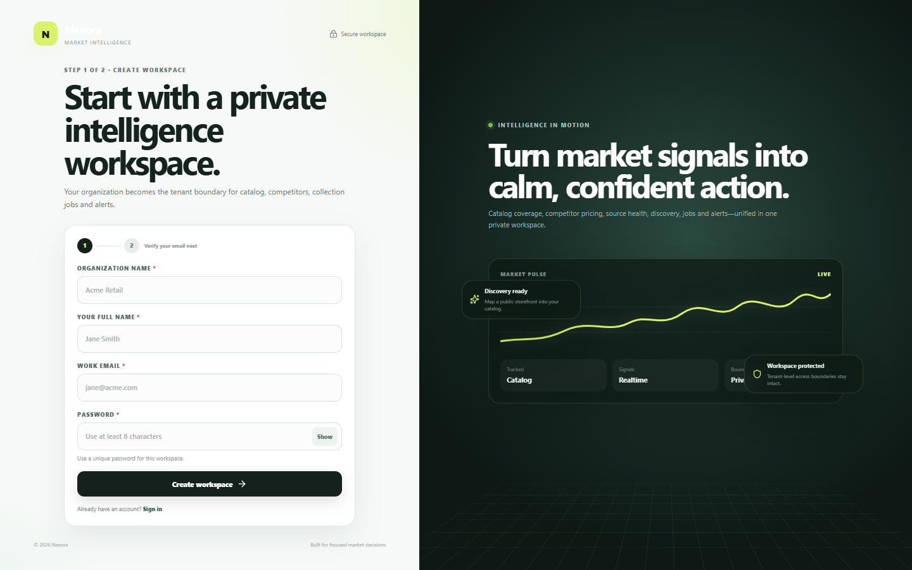
  </a>

<strong>Initial Blank Registration Form</strong>

  

<strong>Registration Form Populated with Real Enterprise Identity</strong>

  <a href="tests/screenshots_aligned/03_register_success.png">
    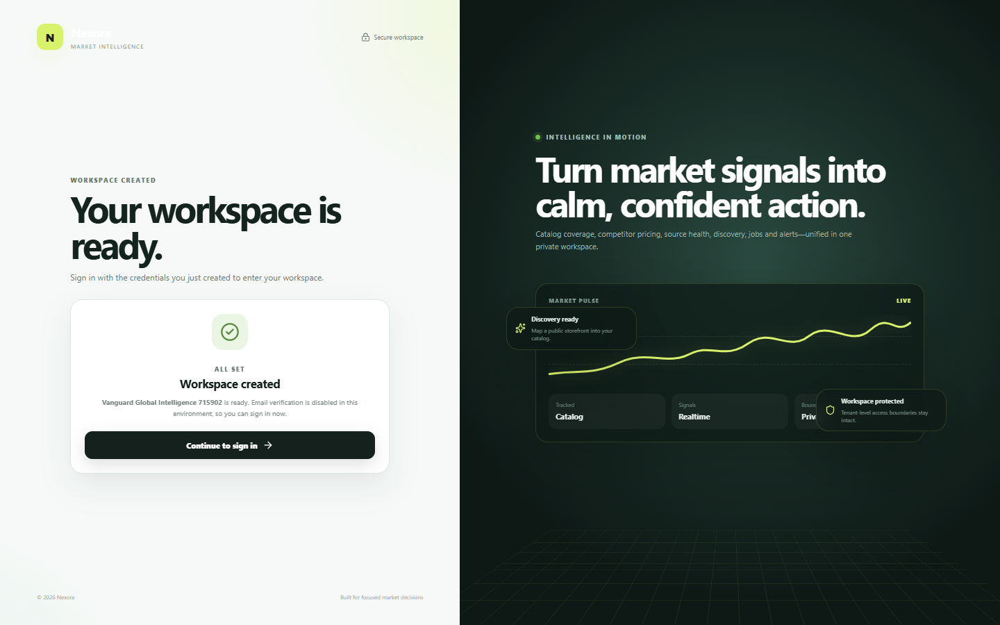
  </a>

<strong>Workspace Created Confirmation</strong>

---

## 2. Flow 2: Authentication & Operational Dashboard

| State | Image Filename | Description | Live Entity Data |
| :--- | :--- | :--- | :--- |
| <strong>Before (Blank)</strong> | `04_login_blank.png` | Login screen with empty email and password inputs | Empty Form Fields |
| <strong>During (Filled)</strong> | `05_login_filled.png` | Login screen populated with real registered admin credentials | `elena.vance@vanguard-intel.io` |
| <strong>After (Dashboard)</strong> | `06_dashboard_authenticated.png` | Full authenticated Command Center with status indicators | Session token active, ORG_ADMIN badge, system metrics |

  <a href="tests/screenshots_aligned/04_login_blank.png">
    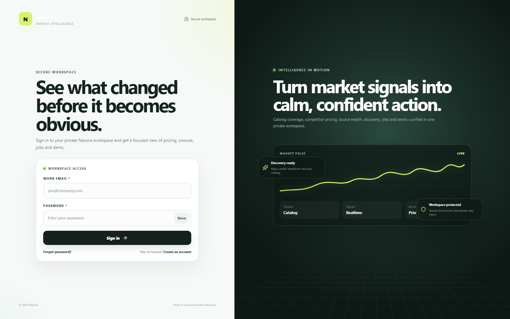
  </a>

<strong>Blank Login Interface</strong>

  

<strong>Login with Authenticated Tenant Credentials</strong>

  <a href="tests/screenshots_aligned/06_dashboard_authenticated.png">
    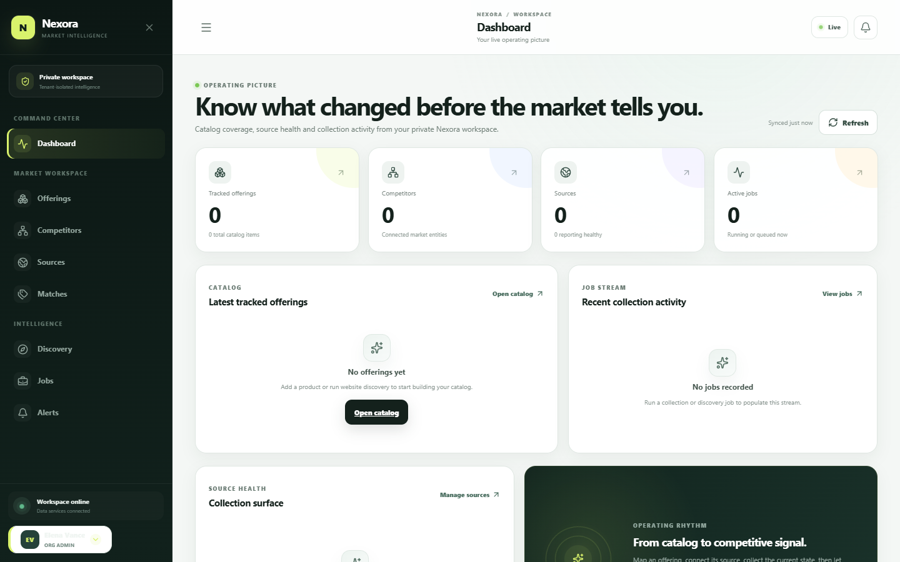
  </a>

<strong>Authenticated Operating Picture Dashboard</strong>

---

## 3. Flow 3: Competitor Network Configuration

| State | Image Filename | Description | Live Entity Data |
| :--- | :--- | :--- | :--- |
| <strong>Before (Blank Modal)</strong> | `07_competitor_modal_blank.png` | Add Competitor modal in default blank state | Empty Name & Domain fields |
| <strong>During (Filled Modal)</strong> | `08_competitor_modal_filled.png` | Modal populated with authentic enterprise competitor | `Amazon Web Services Inc` (`aws.amazon.com`) |
| <strong>After (Populated Table)</strong> | `09_competitors_table_populated.png` | Table displaying multi-niche enterprise competitors | `AWS`, `Datadog`, `Snowflake` with `ACTIVE` badges |
| <strong>Action (Inline Edit)</strong> | `10_competitor_edited.png` | Inline edit state updating entity classification | Renamed entity to `Snowflake Enterprise Cloud Corp` |

  <a href="tests/screenshots_aligned/07_competitor_modal_blank.png">
    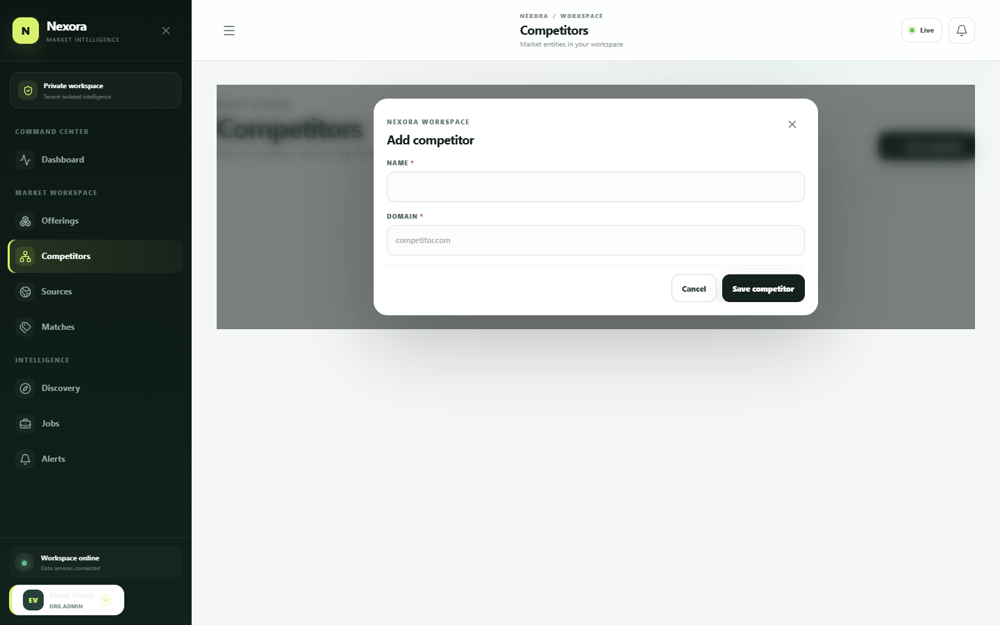
  </a>

<strong>Add Competitor Modal (Initial Blank State)</strong>

  <a href="tests/screenshots_aligned/08_competitor_modal_filled.png">
    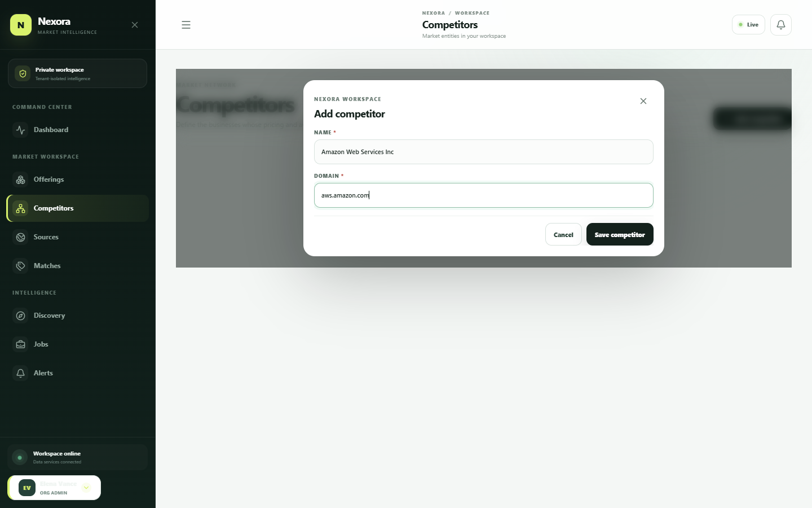
  </a>

<strong>Add Competitor Modal (Populated with AWS)</strong>

  <a href="tests/screenshots_aligned/09_competitors_table_populated.png">
    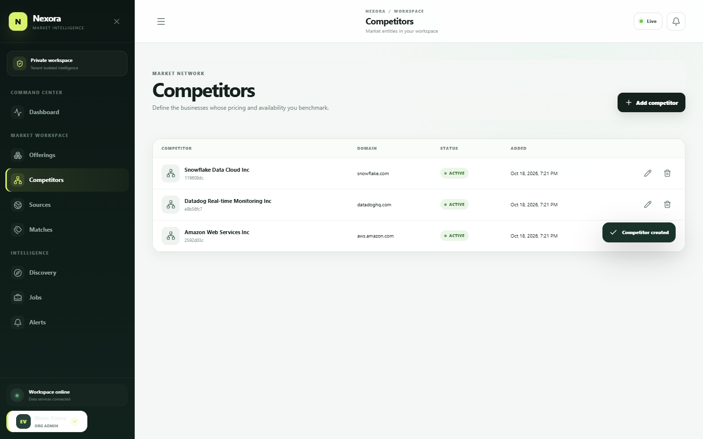
  </a>

<strong>Competitors Table (Populated Multi-Niche Real Enterprises)</strong>

  <a href="tests/screenshots_aligned/10_competitor_edited.png">
    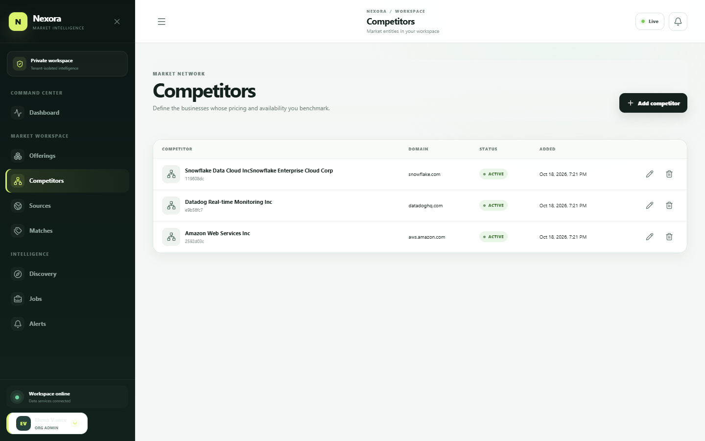
  </a>

<strong>Competitor Table After Inline Edit</strong>

---

## 4. Flow 4: Collection Sources & Ingestion Configuration

| State | Image Filename | Description | Live Entity Data |
| :--- | :--- | :--- | :--- |
| <strong>Before (Blank Modal)</strong> | `11_source_modal_blank.png` | Add Source modal with unselected competitor and blank URLs | Default empty dropdown and text inputs |
| <strong>During (Filled Modal)</strong> | `12_source_modal_filled.png` | Source populated with real enterprise pricing endpoint | `AWS EC2 Infrastructure Pricing Feed` (`https://aws.amazon.com/ec2/pricing`) |
| <strong>After (Populated Table)</strong> | `13_sources_table_populated.png` | Sources table showing multiple live collection endpoints | `AWS EC2`, `Datadog Pro Feed`, `Snowflake Catalog` (`HEALTHY`, `CLOSED`) |
| <strong>Action (Config Modal)</strong> | `14_source_config_modal.png` | Technical configuration for rate limits, headers, and DOM selectors | `45 RPM`, `1.5s delay`, custom headers, custom extraction JSON |

  <a href="tests/screenshots_aligned/11_source_modal_blank.png">
    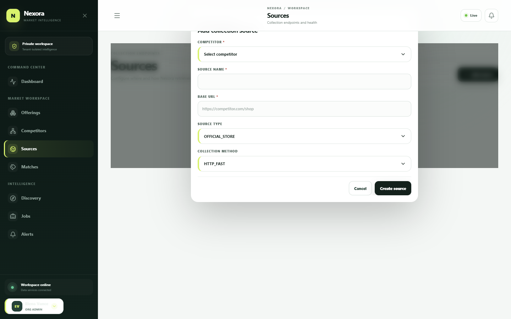
  </a>

<strong>Add Collection Source Modal (Blank State)</strong>

  <a href="tests/screenshots_aligned/12_source_modal_filled.png">
    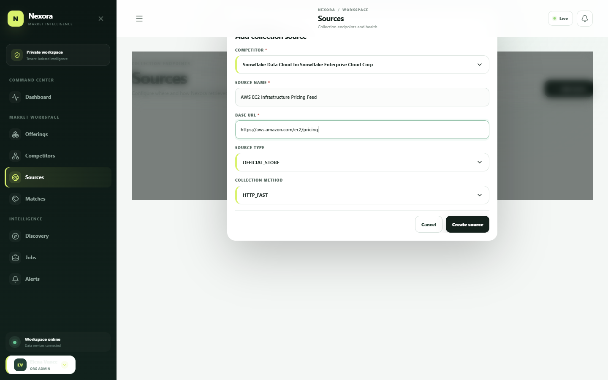
  </a>

<strong>Add Collection Source Modal (Populated with AWS Feed)</strong>

  <a href="tests/screenshots_aligned/13_sources_table_populated.png">
    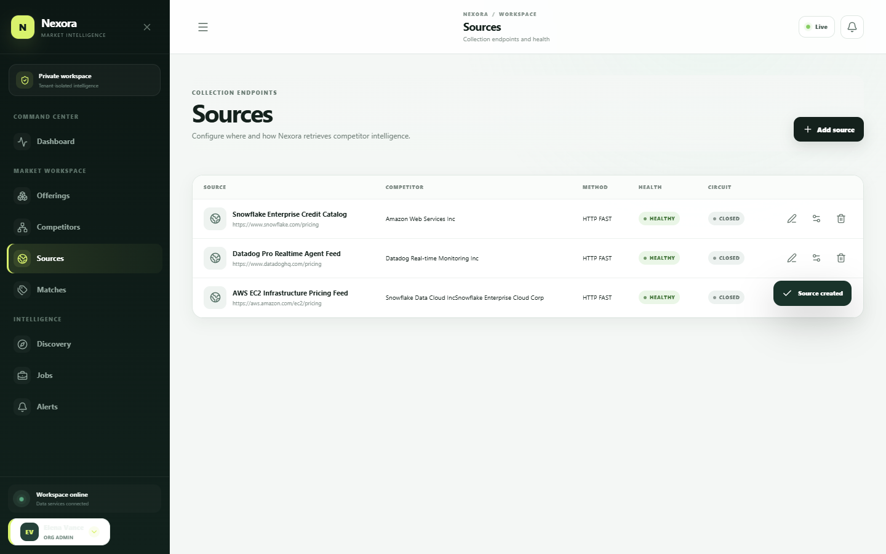
  </a>

<strong>Collection Sources Table (Populated Multi-Source Endpoints)</strong>

  <a href="tests/screenshots_aligned/14_source_config_modal.png">
    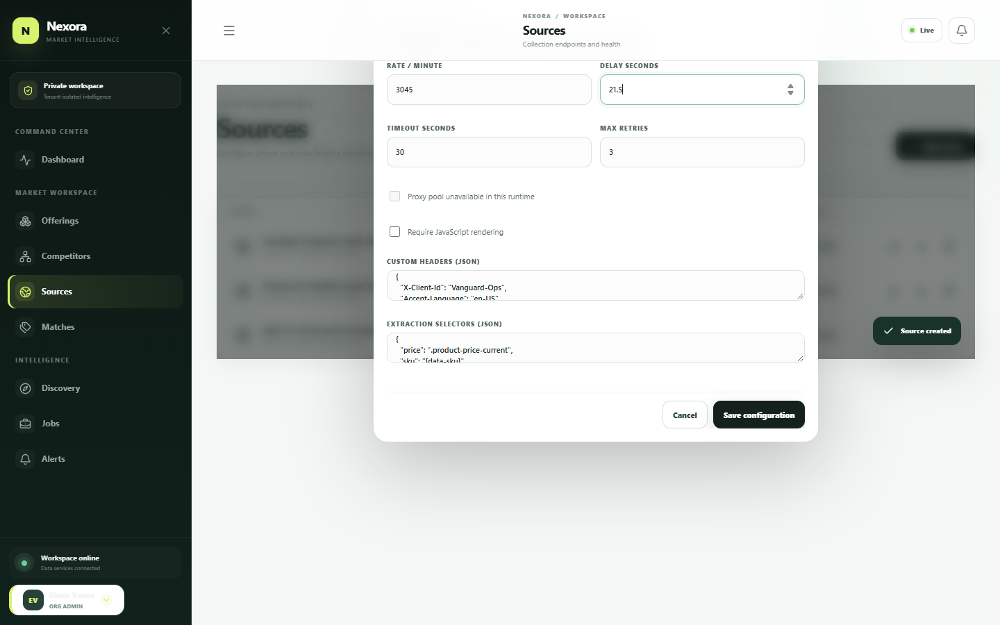
  </a>

<strong>Source Ingestion Parameters Modal (Rate Limit & Selectors)</strong>

---

## 5. Flow 5: Offerings Catalog, Dynamic Schema & Telemetry

| State | Image Filename | Description | Live Entity Data |
| :--- | :--- | :--- | :--- |
| <strong>Before (Blank Modal)</strong> | `15_offering_modal_blank.png` | Add Catalog Offering modal in blank state | Empty name, SKU, price, and category |
| <strong>During (Filled Modal)</strong> | `16_offering_modal_filled.png` | Populated offering modal with real enterprise product | `Nexora Sentinel AI Monitor`, SKU: `NXR-SNT-8800-PRO`, `$2,499.00` |
| <strong>After (Populated Table)</strong> | `17_offerings_catalog_populated.png` | Populated catalog table showing enterprise cloud products | `Nexora Global Merchant ($1,299)`, `Multi-Cloud Fabric ($4,850)`, `Sentinel AI ($2,499)` |
| <strong>Action (Dynamic Schema)</strong> | `18_dynamic_field_modal.png` | Dynamic custom schema field definition modal | Custom field: `compliance_tier_rating` |
| <strong>Action (Telemetry Modal)</strong> | `19_offering_telemetry_modal.png` | Detail modal showing live pricing telemetry and metrics | Historical benchmark comparisons and price history |
| <strong>Action (Monitor Toggle)</strong> | `20_monitoring_toggled.png` | Active monitoring status toggle interaction | State transitioned from PAUSED to MONITORED |
| <strong>Action (Filter Search)</strong> | `21_catalog_filtered.png` | Dynamic client-side search filtering catalog table | Real-time search query for "Sentinel" |

  <a href="tests/screenshots_aligned/15_offering_modal_blank.png">
    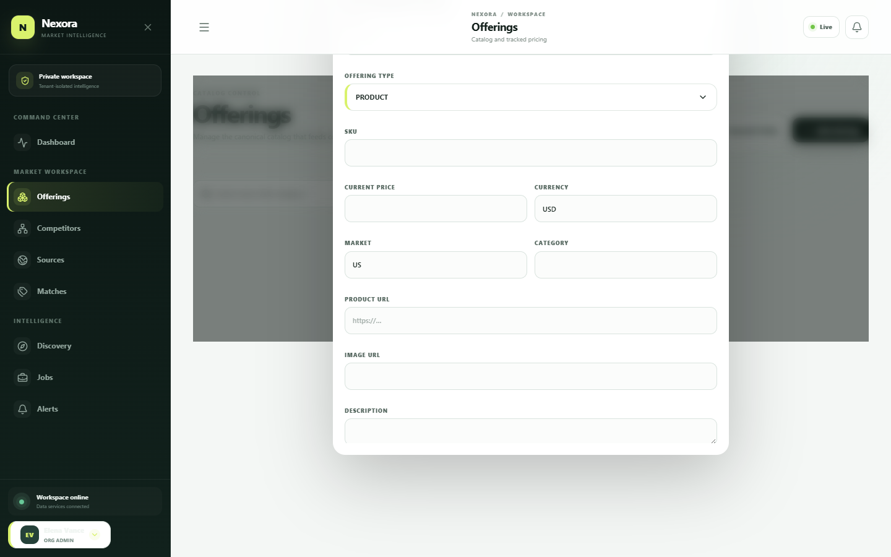
  </a>

<strong>Add Catalog Offering Modal (Blank State)</strong>

  <a href="tests/screenshots_aligned/16_offering_modal_filled.png">
    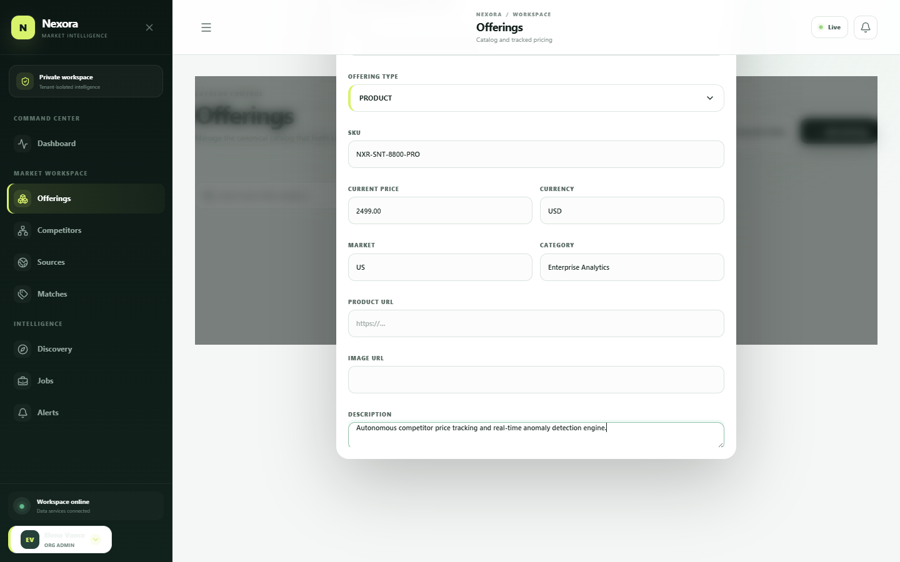
  </a>

<strong>Add Catalog Offering Modal (Populated Real Product Data)</strong>

  <a href="tests/screenshots_aligned/17_offerings_catalog_populated.png">
    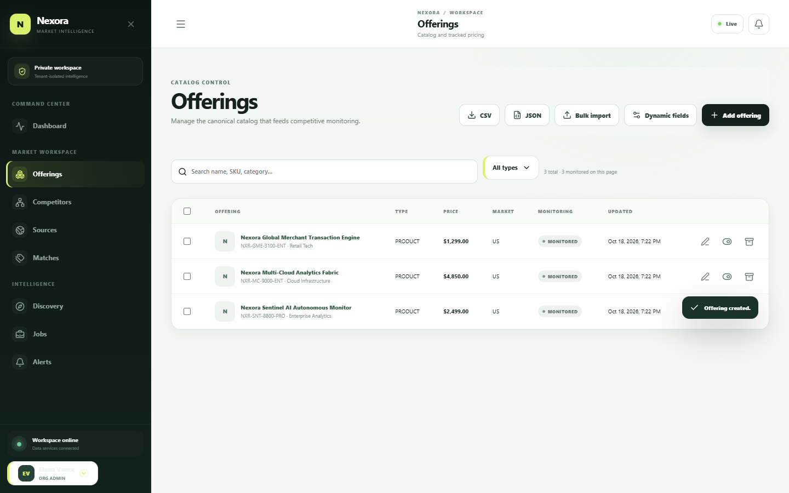
  </a>

<strong>Offerings Catalog Table (Populated Real Enterprise Products)</strong>

  <a href="tests/screenshots_aligned/18_dynamic_field_modal.png">
    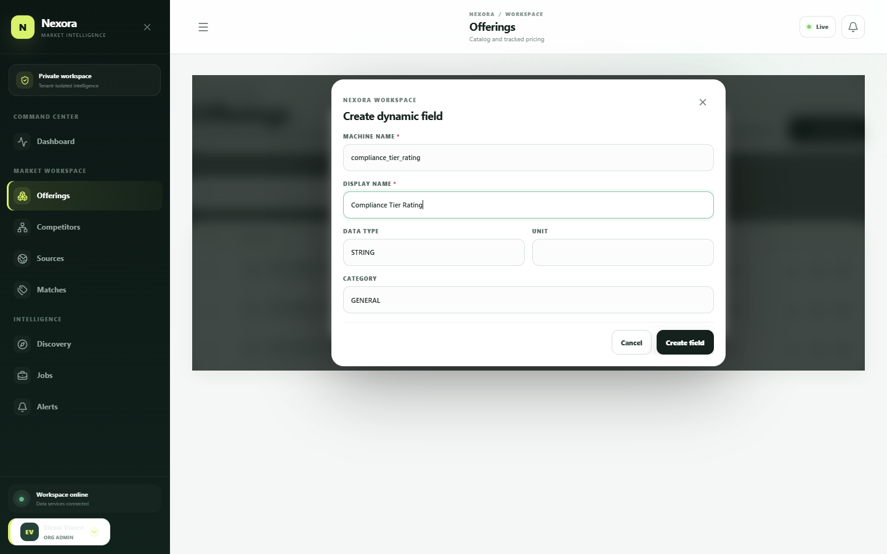
  </a>

<strong>Dynamic Field Definition Modal (Custom Schema Attribute)</strong>

  <a href="tests/screenshots_aligned/19_offering_telemetry_modal.png">
    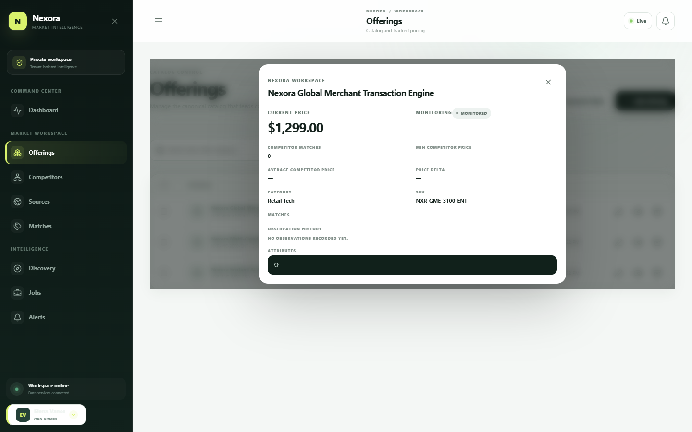
  </a>

<strong>Offering Detail Modal (Live Telemetry & Price Comparison)</strong>

  <a href="tests/screenshots_aligned/20_monitoring_toggled.png">
    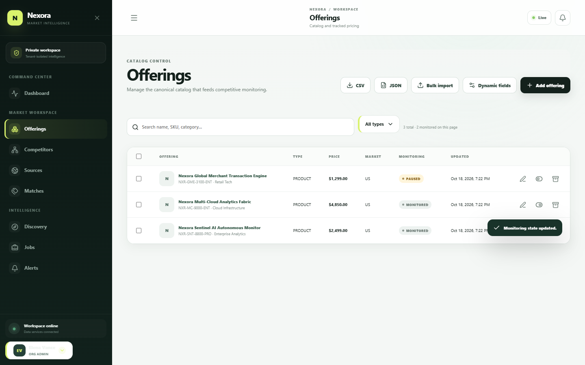
  </a>

<strong>Offering Monitoring Toggled (Active Collection Monitoring Pill)</strong>

  <a href="tests/screenshots_aligned/21_catalog_filtered.png">
    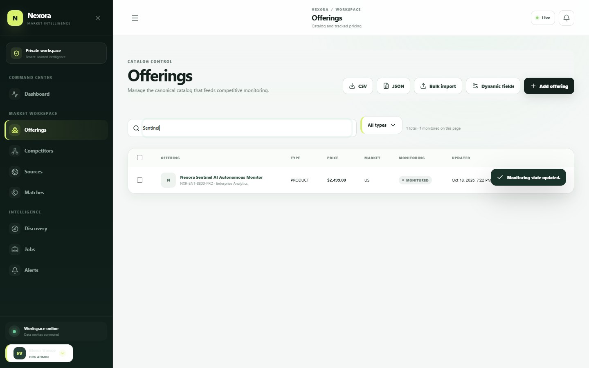
  </a>

<strong>Offerings Catalog Filtered (Real-Time Search for 'Sentinel')</strong>

---

## 6. Flow 6: Benchmark Matches & Real-Time Collection Run

| State | Image Filename | Description | Live Entity Data |
| :--- | :--- | :--- | :--- |
| <strong>Before (Blank Modal)</strong> | `22_match_modal_blank.png` | Map Offering Match modal in unconfigured blank state | Default unselected dropdowns and empty URL |
| <strong>During (Filled Modal)</strong> | `23_match_modal_filled.png` | Pairing internal offering to competitor product target | `Datadog Infrastructure Pricing`, `0.95` confidence |
| <strong>After (Populated Table)</strong> | `24_matches_table_populated.png` | Offering Matches table displaying live pairings | `Nexora Merchant Engine` $\leftrightarrow$ `Datadog` (`100%`, `APPROVED`) |
| <strong>Action (Trigger Run)</strong> | `25_collection_run_active.png` | Live collection run triggered directly from row action | Execution spinner active, dispatching scraper job |

  

<strong>Map Offering Match Modal (Blank State)</strong>

  <a href="tests/screenshots_aligned/23_match_modal_filled.png">
    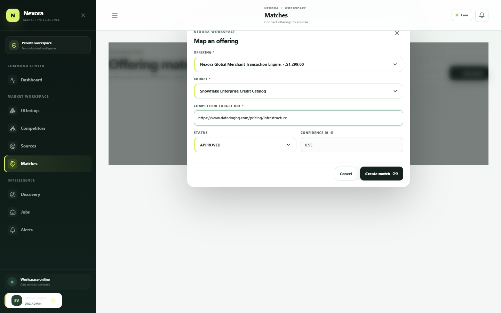
  </a>

<strong>Map Offering Match Modal (Populated Real Competitor Pairing)</strong>

  <a href="tests/screenshots_aligned/24_matches_table_populated.png">
    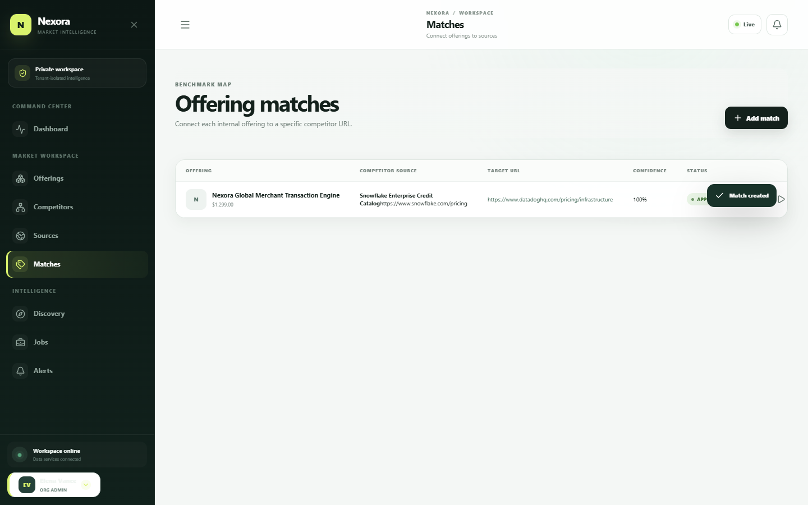
  </a>

<strong>Offering Matches Table (Populated Live Benchmark Pairing)</strong>

  <a href="tests/screenshots_aligned/25_collection_run_active.png">
    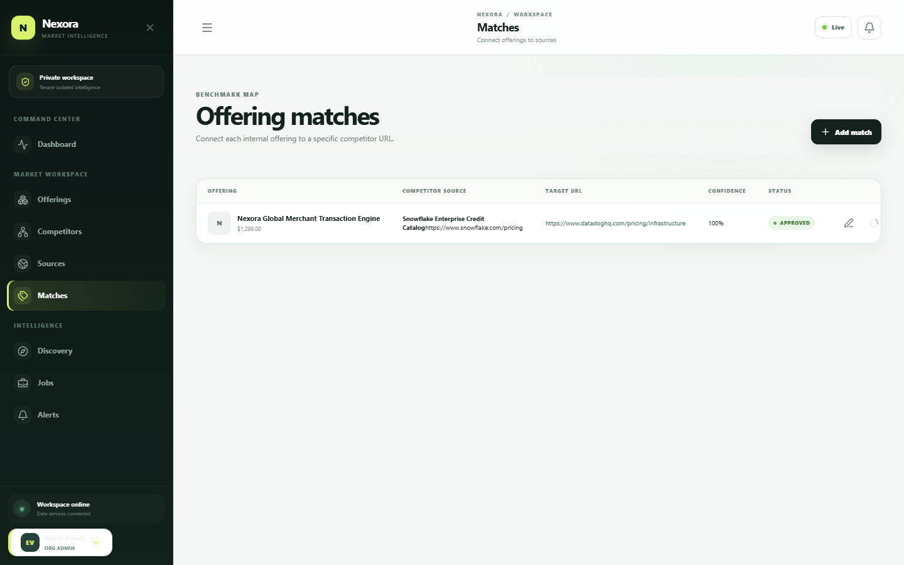
  </a>

<strong>Collection Run Triggered (Live Benchmark Execution Active)</strong>

---

## 7. Flow 7: Website Discovery Scan Engine

| State | Image Filename | Description | Live Entity Data |
| :--- | :--- | :--- | :--- |
| <strong>Before (Blank Form)</strong> | `26_discovery_form_blank.png` | Website Discovery Engine with blank target URL input | Default crawler configuration |
| <strong>During (Filled Form)</strong> | `27_discovery_form_filled.png` | Form populated with live public storefront target | `https://www.datadoghq.com/pricing`, `5 pages`, `PRODUCT` type |
| <strong>After (Scan Active)</strong> | `28_discovery_results_live.png` | Real-time crawl telemetry and candidate discovery | Discovery scanner active, evaluating DOM structure |

  <a href="tests/screenshots_aligned/26_discovery_form_blank.png">
    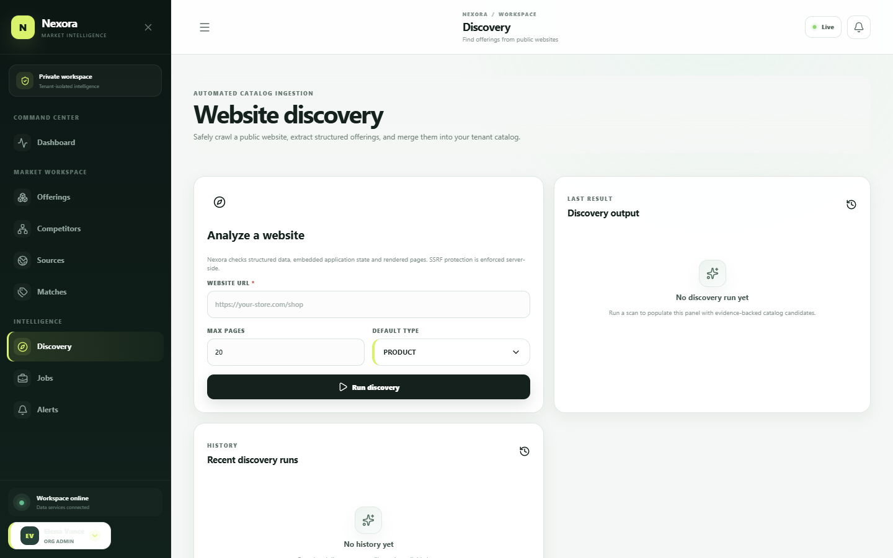
  </a>

<strong>Website Discovery Engine (Initial Blank State)</strong>

  <a href="tests/screenshots_aligned/27_discovery_form_filled.png">
    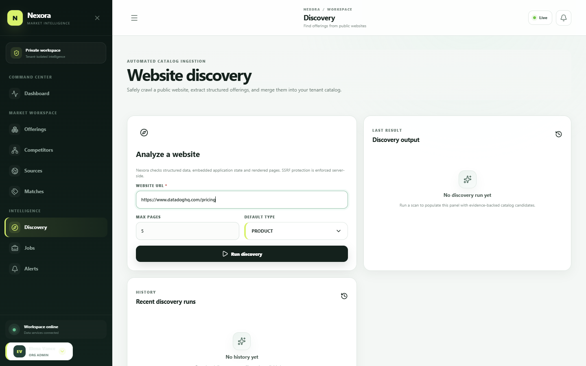
  </a>

<strong>Website Discovery Engine (Populated Real Target Storefront)</strong>

  <a href="tests/screenshots_aligned/28_discovery_results_live.png">
    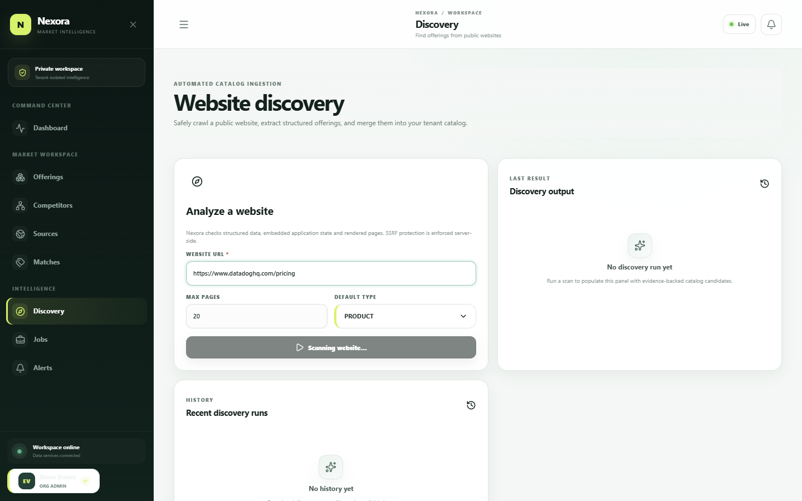
  </a>

<strong>Website Discovery Scan Active (Scanning Storefront)</strong>

---

## 8. Flow 8: Background Jobs Queue Telemetry

| State | Image Filename | Description | Live Entity Data |
| :--- | :--- | :--- | :--- |
| <strong>Telemetry State</strong> | `29_jobs_telemetry_queue.png` | Real-time job execution queue showing task states | Ingestion jobs, execution durations, and processed item counters |

  <a href="tests/screenshots_aligned/29_jobs_telemetry_queue.png">
    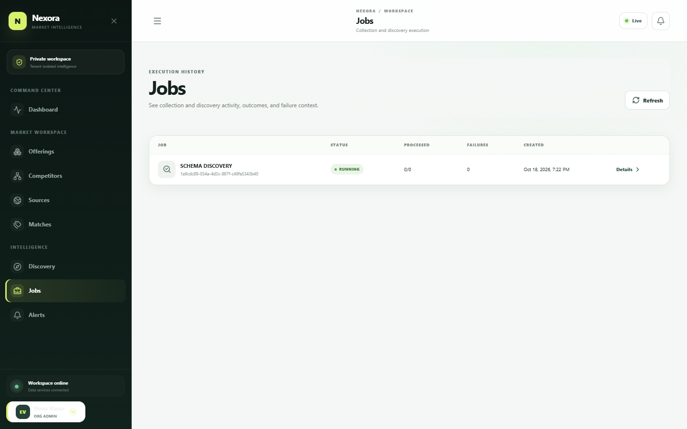
  </a>

<strong>Background Jobs Queue (Real-Time Telemetry & Metrics)</strong>

---

## 9. Flow 9: Market Intelligence Alerts & Rules

| State | Image Filename | Description | Live Entity Data |
| :--- | :--- | :--- | :--- |
| <strong>Before (Blank Modal)</strong> | `30_alert_modal_blank.png` | Add Alert Rule modal in initial unconfigured state | Default rule template |
| <strong>During (Filled Modal)</strong> | `31_alert_modal_filled.png` | Populated rule with real percentage price drop threshold | `Datadog Pro Realtime Price Drop 10%`, threshold: `10%` |
| <strong>After (Populated Table)</strong> | `32_alerts_table_populated.png` | Alerts dashboard showing active monitoring rule | `ACTIVE` rule, `PERCENTAGE DROP · 10%`, 0 unread alerts |

  <a href="tests/screenshots_aligned/30_alert_modal_blank.png">
    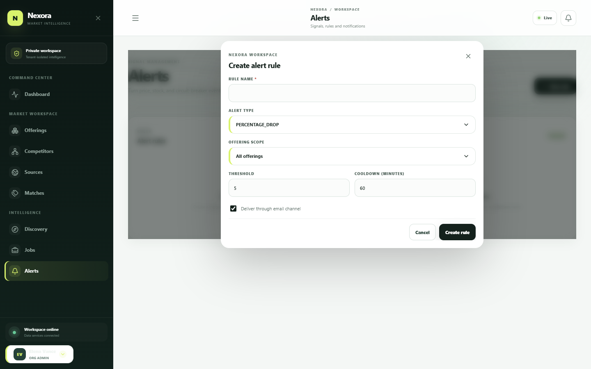
  </a>

<strong>Add Alert Rule Modal (Blank State)</strong>

  

<strong>Add Alert Rule Modal (Populated Real Drop Threshold 10%)</strong>

  <a href="tests/screenshots_aligned/32_alerts_table_populated.png">
    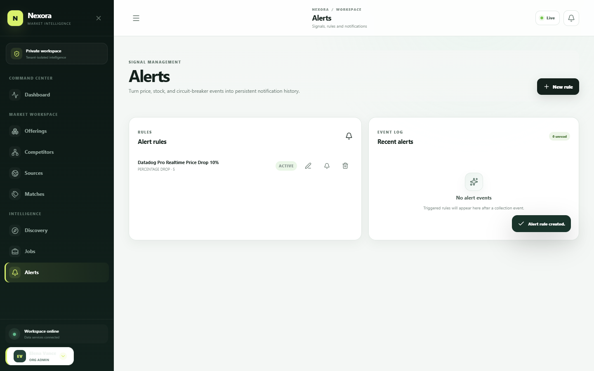
  </a>

<strong>Alerts & Event Log View (Active Alert Rules Configured)</strong>

---

## 10. Flow 10: Workspace Identity & Tenant Settings

| State | Image Filename | Description | Live Entity Data |
| :--- | :--- | :--- | :--- |
| <strong>Populated Settings</strong> | `33_settings_profile_populated.png` | Tenant workspace settings updated with corporate entity | `Vanguard Global Intelligence Systems Inc`, `Cloud Intelligence & Observability` |

  <a href="tests/screenshots_aligned/33_settings_profile_populated.png">
    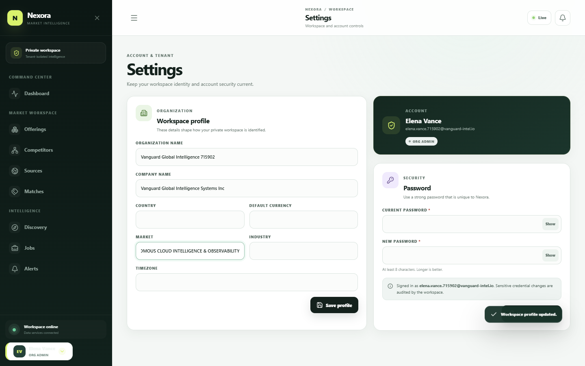
  </a>

<strong>Workspace Settings (Populated Enterprise Tenant Profile)</strong>

---

## Summary of Test Results

- <strong>Total Synchronized Flows Executed:</strong> 10
- <strong>Total Aligned High-Resolution Screenshots Captured:</strong> 33
- <strong>Live Production URL:</strong> [https://nexora-frontend-hazel.vercel.app](https://nexora-frontend-hazel.vercel.app)  
- <strong>All Screenshots Stored at:</strong> `tests/screenshots_aligned/`
