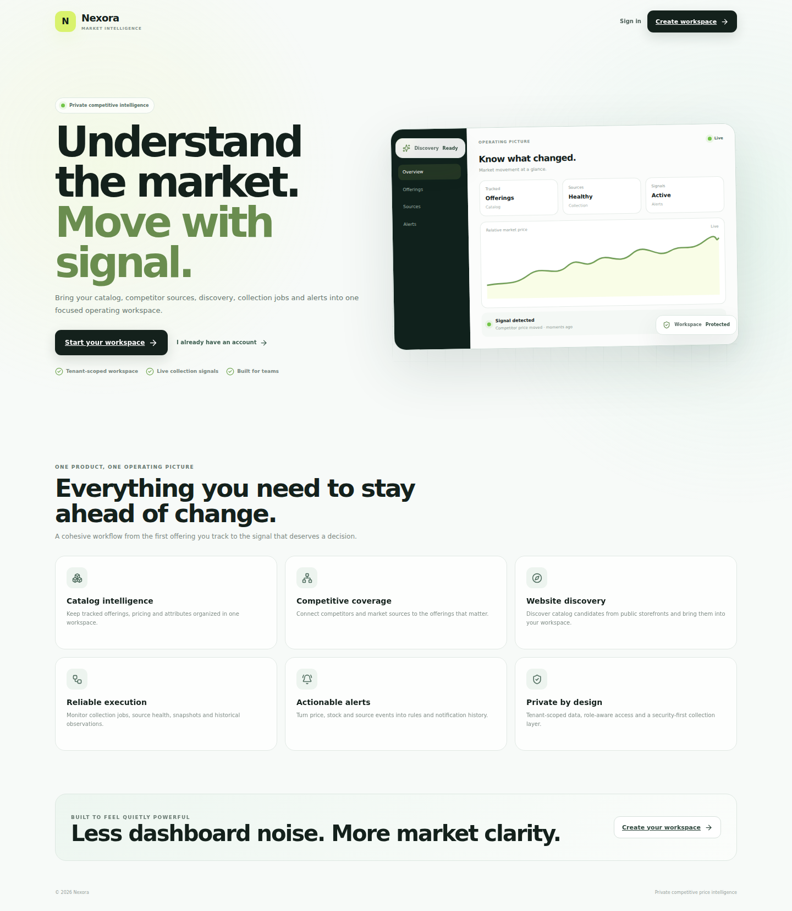
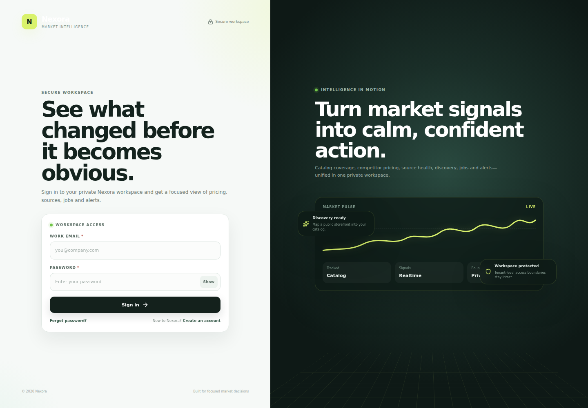
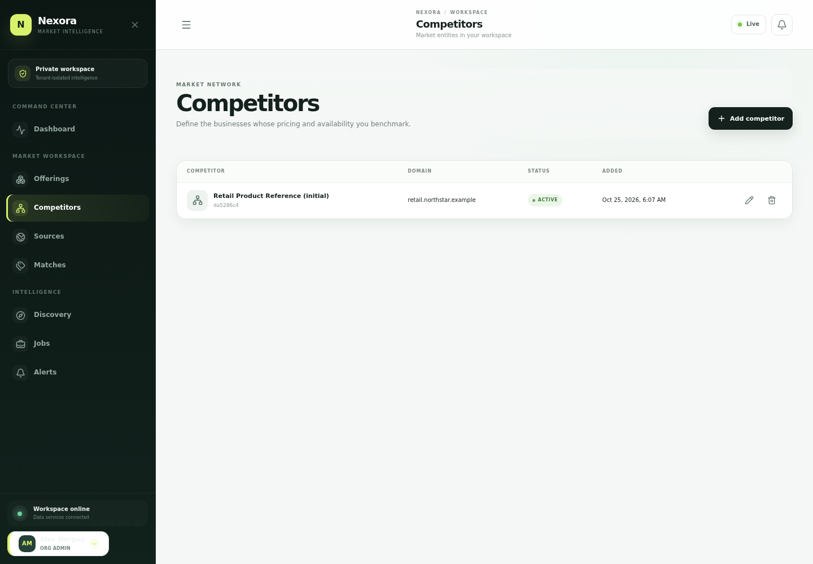
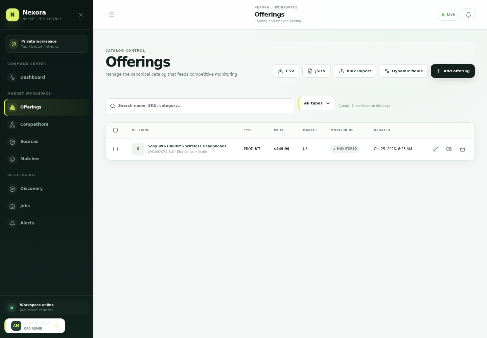
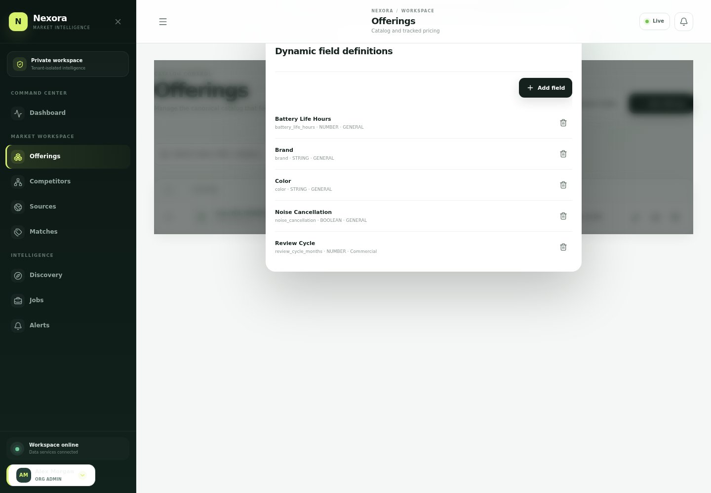
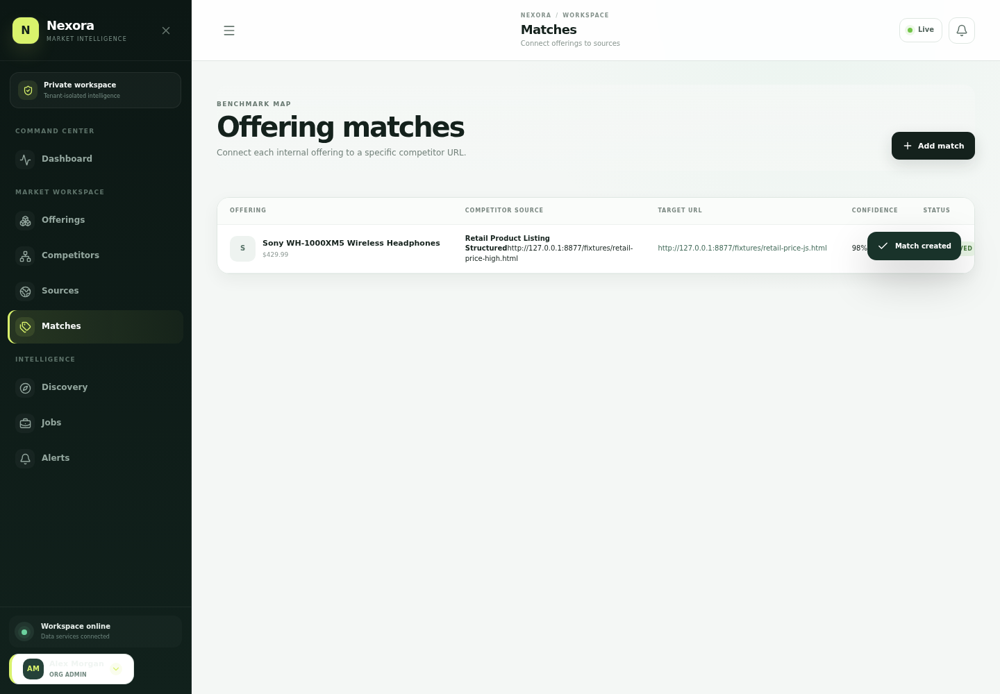

# Nexora — Product Walkthrough

Nexora is a private competitive-intelligence workspace that connects a company's own catalog to competitor offerings, public pricing sources, collection history, discovery, and actionable alerts.

This guide follows a market analyst's workspace from first sign-in to a price movement that becomes a saved alert. Each screen belongs to the same service journey: the interface sends requests to the Nexora API, and the resulting records are stored in the workspace database.

## 1. Create a private workspace

Start at the public homepage, create an organization, verify the email address, and sign in. Account verification and password recovery use one-time links delivered to the mailbox configured for the workspace.

The dashboard is the entry point to the workspace. It brings tracked offerings, competitors, collection sources, and current jobs into one operating picture.

## 2. Define the competitive landscape

A competitor is a business or market entity Nexora should monitor. The domain is unique inside the workspace, helping the team avoid duplicate entries.

Sources describe where pricing or availability information is collected and how Nexora should access the page. The configuration holds request pacing, timeouts, retry policy, headers, and extraction selectors.

## 3. Build and maintain the catalog

The catalog is the internal reference for the products, plans, or services the organization cares about. Core fields such as SKU, price, currency, market, and category sit alongside flexible attributes such as brand, color, battery life, or vertical-specific specifications.

Opening an offering reveals its details and history. Monitoring can be paused or resumed without removing the catalog record.

Dynamic fields give a workspace control over attributes that are specific to its business domain.

For larger catalogs, bulk import creates multiple offerings in one operation. CSV and JSON exports support downstream analysis; archived items can be retained for history without appearing in the active catalog.

## 4. Connect an offering to a competitor and collect a price

An offering match ties an internal catalog record to a particular competitor URL. It records the match state and confidence, so the team can review which competitive comparisons are ready for monitoring.

Running a collection fetches the public page using Nexora's collection pipeline. Extracted price, currency, availability, and page attributes become an observation; the latest snapshot preserves the previous price for comparison.

## 5. Turn price movement into an alert

Rules can watch for percentage drops, price changes, undercutting, stock changes, or source-health events. Rules can be scoped to one offering or applied across the workspace, with configurable thresholds and cooldowns.

When the next collection observes a drop from $399.99 to $349.99, Nexora stores the change in its snapshot history and creates an alert because the movement crosses the configured 10% threshold. Alert events remain in the workspace, can be marked read, and can be delivered through the notification outbox.

## 6. Follow collection and discovery activity

Jobs provide the operational history behind collection and discovery. Each entry shows its status and processing outcome, and its detail view keeps the run identifier, source, and metadata together.

Website discovery walks a public site, looks for structured product evidence, and merges valid candidates into the catalog. Requests to private or loopback destinations are rejected by the server-side URL security boundary.

A later scan updates the existing catalog item when its identity matches; it does not create another copy of the same discovered SKU.

## 7. Workspace administration and account security

Organization administrators can maintain the workspace profile, including company identity, market, currency, industry, and timezone.

Signed-in users can change a password, and account recovery uses a separate expiring reset link. A reset invalidates the previous refresh sessions before the user signs in again.

Access is role-aware. Analysts can work with read and analysis features while administrator-only controls are withheld; viewers can browse permitted information without catalog or competitor write controls.

## 8. Responsive entry point

The public entry page adapts to a narrow viewport so a visitor can understand the product and reach account creation without a horizontally overflowing layout.

---

The walkthrough uses a dedicated review workspace and public structured-data pages. It is a guide to how Nexora's core customer journey fits together, not a certification of a separately deployed production environment.
