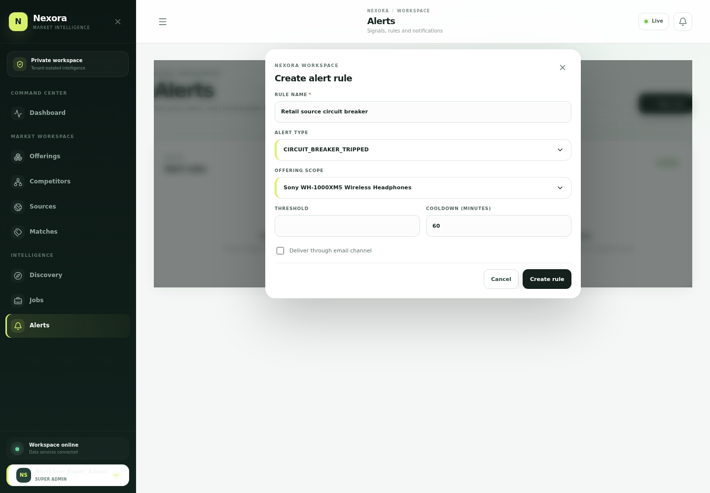
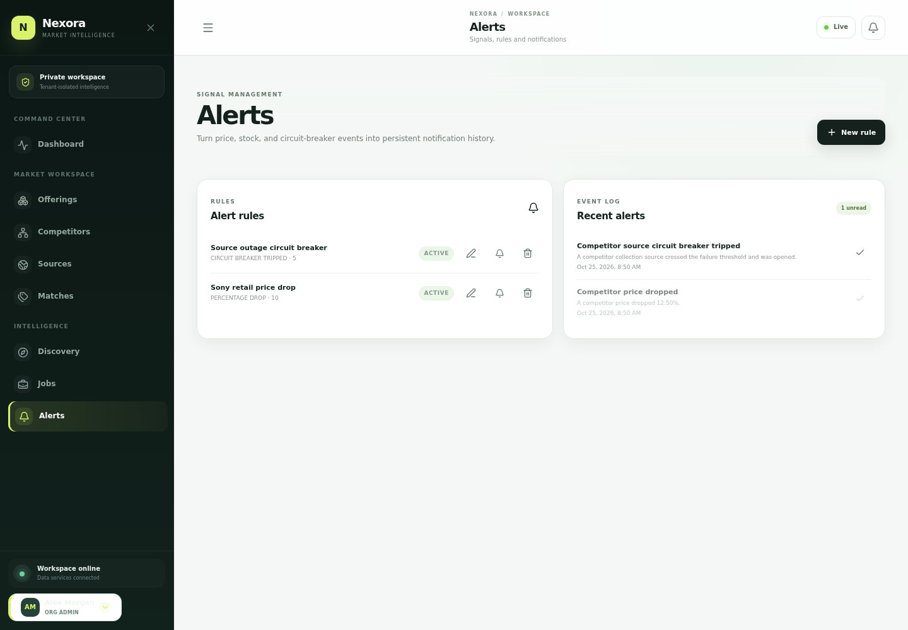

# Nexora — Product Walkthrough

Nexora is a private market-intelligence workspace for teams who need to understand catalog coverage, competitor pricing, product availability, and changes in the market.

This walkthrough follows one connected journey: create a workspace, map a competitor, configure a source, organise an offering catalogue, collect market observations, turn a price movement into an alert, discover new catalogue items, and manage access and account security.

## 1. A private workspace

The public entry introduces Nexora's market-intelligence capabilities. An organisation creates its workspace and verifies its email before signing in. Workspace data belongs to that organisation, while role-based access controls which actions each team member can take.

## 2. Map the competitive landscape

Competitors represent the businesses being monitored. Sources describe the public pages Nexora can collect from, including the source type, retrieval method, request limits, retry behavior, and extraction selectors. Duplicate competitor domains are rejected so the workspace does not accidentally create duplicate market entities.

Nexora can use a fast HTTP fetch for ordinary public pages or a browser-rendered page when a source requires JavaScript.

## 3. Build the canonical catalogue

The catalogue stores the team's own products, services, plans, and other offerings. Core commercial data sits alongside dynamic attributes such as brand, category-specific specifications, and other comparable properties. Teams can review an offering's detail and history, change its monitored state, manage dynamic field definitions, bulk import catalog entries, export CSV or JSON, and archive items that are no longer active.

When an import contains a mix of valid and invalid records, Nexora keeps successful rows and shows the rejected row numbers with their reasons so the operator can correct the input.

With larger catalogues, the offering list is paginated. The page controls let the team move through the full set while keeping each page manageable.

Teams can also filter by offering type, for example separating service entries from products while keeping the rest of the catalog searchable.

## 4. Connect offers to market observations

An offering match connects one catalogue entry to a competitor's specific product or pricing page. From that connection, Nexora retrieves the page, extracts available price and availability data, and records an observation and current snapshot. Repeated collections establish a history, including the direction and percentage of price movement.

## 5. Turn market movements into signals

Alert rules describe which events matter to the team, such as a percentage price drop, a fixed price change, availability changes, or a source circuit breaker. Matching observations produce persistent alert history. Team members can review an event and mark it as read, while email delivery uses the notification outbox so delivery status remains traceable.

A source that keeps failing is handled as an operational event, not just a failed job. After repeated unsuccessful collections, Nexora opens the source circuit, prevents immediate repeat requests, and records a circuit-breaker alert for the team to review.

## 6. Follow execution and discover new catalogue items

Collection and discovery jobs retain execution status, counts, timestamps, and useful failure context. Website discovery checks public pages for structured product data and can add new offerings or update matching records. Private and loopback destinations are blocked rather than fetched.

## 7. Workspace controls and account recovery

Workspace settings hold organisation details such as company, country, currency, market, industry, and timezone. Account security includes changing the current password and a one-time email-based reset flow. These controls help teams keep the workspace details and access credentials current.

## 8. Access appropriate to each role

The same workspace can support analysts who inspect market data and initiate discovery, alongside viewers who can inspect permitted data without being able to create catalogue or competitor records. The API enforces these permission boundaries even when requests bypass the interface.

## 9. Live public price reference

The connected example also reads the [Sony Center retail listing](https://shopatsc.com/collections/all/products/wh1000xm5-pmin) at run time rather than assigning a fixed price, because retail prices can change by date and market.

## 10. Designed for smaller screens

The public entry adapts to a mobile viewport while retaining the key route into the workspace.

---

Nexora connects account security, tenant-aware access, catalogue management, competitor sources, collection, discovery, job history, alerts, and notification delivery into one operating workflow.
