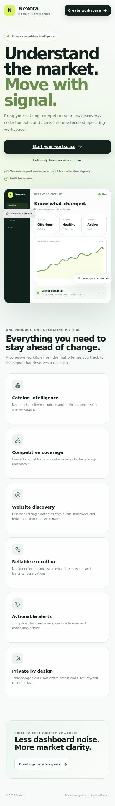

# Nexora | Product Walkthrough

Nexora brings catalog management, competitor coverage, price collection, website discovery and actionable alerts into one private market-intelligence workspace. This guide follows the journey from creating a workspace to turning a competitor price movement into a useful signal.

The screenshots show the product's visible screens and the connected workflow behind them. Values and examples use a retail-product scenario; the same catalog model supports other offering types, including services, subscriptions, rooms, rentals and plans.

## 1. Start with a private workspace

Create an organization workspace, verify the work email, and sign in. Account verification and recovery links are delivered by email, and the workspace opens with a dashboard suited to the signed-in role.

## 2. Configure market coverage

Competitors identify the businesses being benchmarked. Sources define the public pages Nexora can collect from and include request pacing, timeout, retry, header and extraction-selector settings. A domain cannot be registered twice in the same workspace.

## 3. Build and maintain the catalog

The catalog holds the canonical offering name, SKU, price, currency, market, category, description and dynamic attributes. Open an offering to view its details and market comparison, change whether it is monitored, add workspace-specific fields, import multiple offerings, export CSV or JSON, and archive items that should no longer appear in the active catalogue.

## 4. Connect an offering to competitor prices

An offering match connects one of your catalog entries to a specific source URL. Running a collection fetches that public page, extracts the available price and product signals, and stores the observation, the current snapshot, and execution details.

Once market observations exist, the dashboard brings catalog coverage, competitors, source health and collection activity into one view.

## 5. Turn market movements into alerts

Alert rules can watch for price movement, percentage drops, undercut thresholds, stock changes and source circuit-breaker events. Events remain in the alert history so a team member can review and acknowledge them. Email notifications use a delivery outbox so the workspace retains delivery status.

Collection and discovery history help the team understand the outcome of each run and inspect its saved details.

## 6. Discover catalog items from a website

Website discovery can inspect a public storefront for structured product data and merge evidence-backed findings into the catalog. Nexora rejects private or loopback targets, and a repeat scan updates a matching offering rather than duplicating it.

## 7. Workspace identity and account security

Workspace settings hold the organization profile and market defaults. Users can update their password while signed in or use a one-time recovery link if they lose access.

## 8. Role-aware workspace views

The interface exposes actions according to the user's role, and the backend enforces the same permissions. Analysts can work with intelligence and discovery without changing administrative configuration; viewers can inspect permitted workspace data without gaining catalog or competitor write access.

Nexora's public entry point also adapts to smaller screens.

## Feature map

| Workspace area | What it brings together |
|---|---|
| Dashboard | Catalog coverage, competitors, source health, recent collection and discovery activity |
| Competitors | Competitor records, domain uniqueness and workspace-scoped administration |
| Sources | Source type, collection method, health, circuit state, retry policy, request pacing and selectors |
| Offerings | Product and service catalog, dynamic attributes, search, filtering, pagination, monitoring, detail, history and archive |
| Bulk catalog tools | Multi-offering import, bulk archive, CSV export and JSON export |
| Offering matches | Catalog-to-source URL mappings, match confidence and approved/suggested/rejected states |
| Collections | Public page retrieval, price and availability extraction, observations, snapshots and price movement |
| Discovery | Public website crawling, structured data extraction, target validation, merge and update history |
| Jobs | Collection/discovery run status, outcome counts and execution details |
| Alerts | Rule thresholds, cooldowns, rule activation, event history, read state and email notification delivery |
| Settings | Organization profile, country, market, currency, industry, timezone and password controls |
| Access boundaries | Tenant-level data separation and role-aware read/write permissions |

---

*The workflow and example data in this walkthrough are illustrative of how the Nexora product fits together; your workspace reflects its own catalog, competitors, sources and permissions.*
